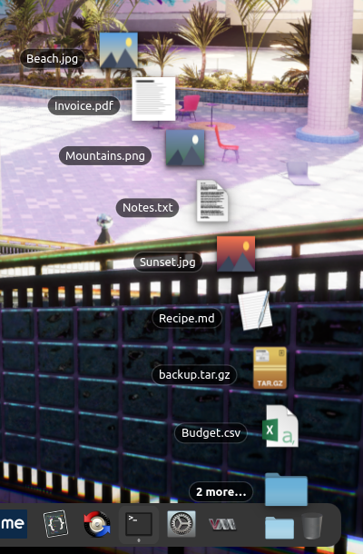

# Fan Stack

A folder on your KDE Plasma 6 panel that fans its newest files out in an
arc, like a macOS Dock stack.



Click the icon to unroll the fan. Click a file to open it, the last entry to
open the folder, anywhere else (or Escape) to fold it back. Middle-click the
icon to open the folder; drop files on it to move them into the folder.

## Installation

Requires KDE Plasma 6 (tested on 6.7, Wayland). The widget reuses Plasma's
own Folder View model, so a normal Plasma Desktop install has everything it
needs.

1. Get the code:

   ```sh
   git clone <repository URL> FanStack
   cd FanStack
   ```

2. Install it for your user:

   ```sh
   ./install.sh
   ```

   This runs `kpackagetool6 --type Plasma/Applet --install .`, or
   `--upgrade .` if an older version is already installed.

3. Right-click a panel, choose **Add Widgets…**, search for **Fan Stack**
   and drag it onto the panel.

4. Right-click the icon and choose **Configure…** to pick the folder
   (Downloads by default), the icon, how many files to show, the curve
   radius, icon size, sort order and animation length.

### Updating

```sh
git pull
./install.sh
qdbus org.kde.plasmashell /PlasmaShell refreshCurrentShell
```

The same `refreshCurrentShell` call reloads the widget after editing its
QML; there is no build step.

### Uninstalling

```sh
kpackagetool6 --type Plasma/Applet --remove com.notalexnoyle.fanstack
```

## License

GPL-2.0-or-later, see `LICENSE`.
